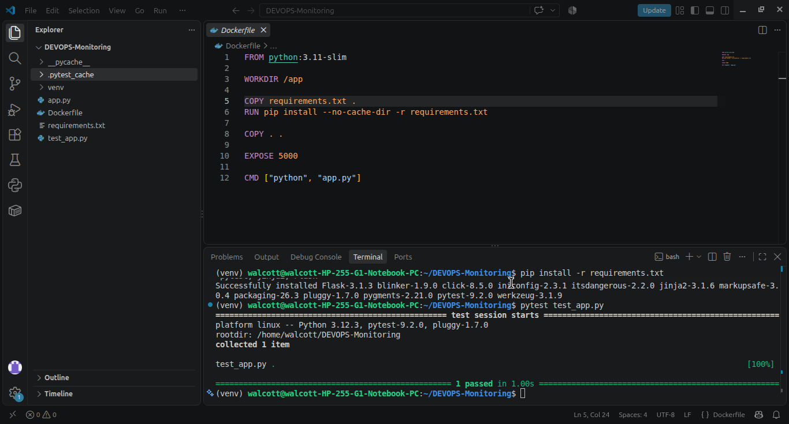
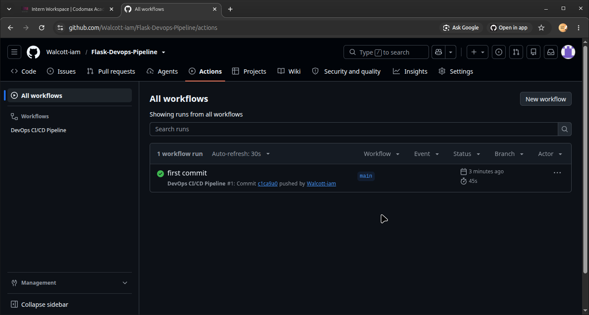
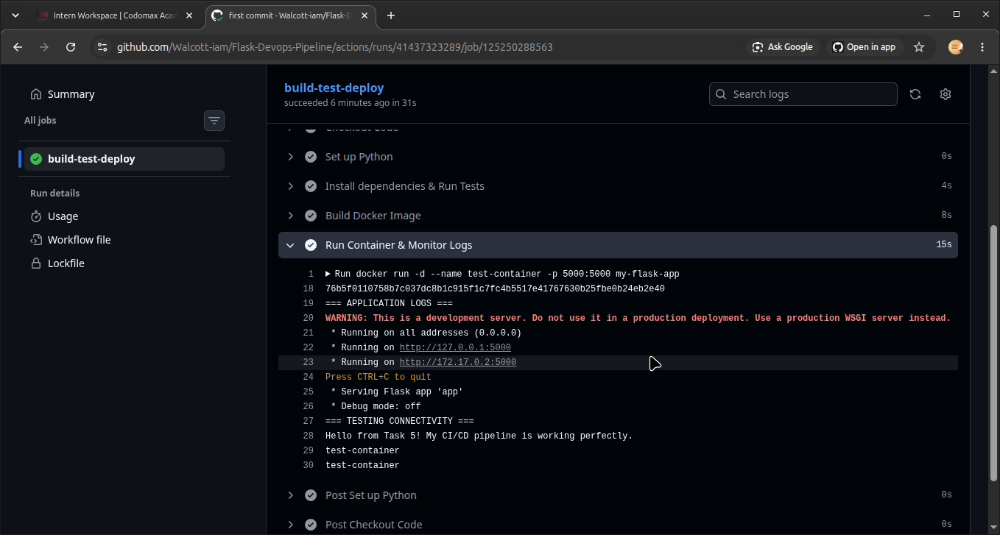
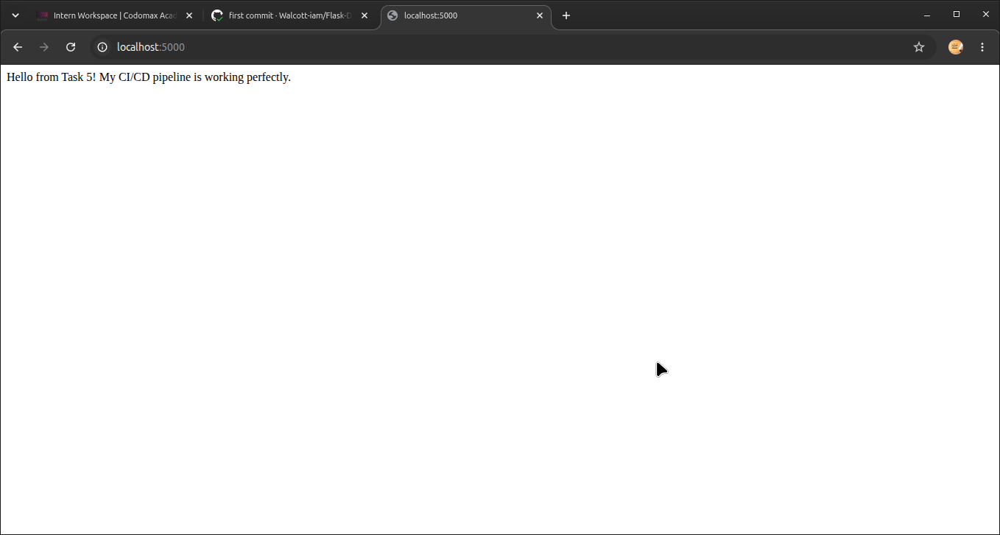

# Flask-Devops-Pipeline
## DevOps CI/CD & Monitoring Pipeline

## Project Overview
This project demonstrates a complete DevOps CI/CD pipeline using GitHub Actions, Docker, and Python. It automates the process of testing, building, and monitoring a web application.

## Architecture & Pipeline Flow
1. **Continuous Integration (CI):** Every push to the `main` branch triggers automated tests using `pytest` to ensure the code is not broken.
2. **Build Automation:** Once tests pass, GitHub Actions builds a Docker image using the `Dockerfile`.
3. **Continuous Deployment & Monitoring:** The pipeline runs the container, captures the live application logs (`docker logs`), and uses `curl` to test connectivity, proving the app is healthy before cleaning up the environment.

## How to Run Locally
To build and run this application on your own machine:
```bash
sudo docker build -t my-flask-app .
sudo docker run -d -p 5000:5000 --name my-live-app my-flask-app
```

Then visit http://localhost:5000 in your browser.

Evidence
1. Local Testing Success


2. GitHub Actions Pipeline Success


3. Monitoring & Logs (Cloud Pipeline)


4. Live Application Running Locally

